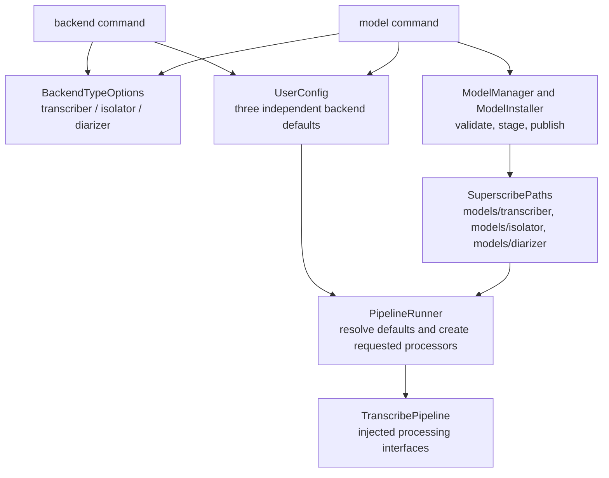
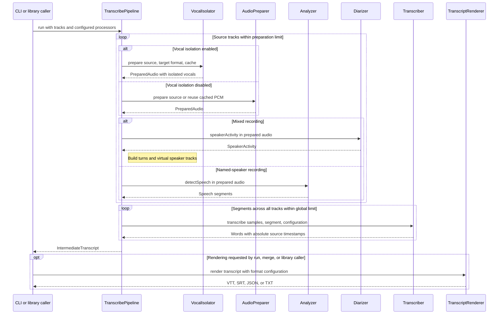

# Superscribe architecture

**Last updated:** 2026-11-04

This document describes the implemented macOS CLI and Swift library. Its filename retains the early project name for existing links. The implementation extends the original MVP scope; unsupported proposals are listed under [Future work](#future-work).

[README.md](../README.md) owns command syntax, options, examples, model locations, and source-build instructions. [AGENTS.md](../AGENTS.md) owns development conventions and test policy. [UPDATES.md](../UPDATES.md) preserves decisions and validation history.

## Scope and package boundaries

Superscribe transcribes recordings that share a common time origin. A named-speaker track supplies its own attribution; a mixed recording is diarized into virtual speaker tracks. Optional vocal isolation removes accompaniment before either segmentation path. The results share one timeline and can be rendered as VTT, SRT, JSON, or TXT.

- `SuperscribeKit` owns audio preparation, isolation, diarization, transcription, model storage, persistence, merging, and formatting. Public processing interfaces are `VocalIsolator`, `Diarizer`, and `Transcriber`.
- The `superscribe` executable owns argument parsing, CLI defaults, installation orchestration, progress, and output files. `PipelineRunner` is shared by `transcribe` and `run`.
- The package minimum is macOS 14 on Apple Silicon. Apple Speech has a macOS 26 runtime gate. The selected Swift toolchain and build prerequisites are documented in the README.

## Backend and model management

A backend identifies an implementation; a model identifies its weights or locale assets. HTDemucs, for example, supports both `htdemucs` and `htdemucs_ft` models.

| Processing type | Backend type and current cases | Runtime interface | Factory |
|---|---|---|---|
| Transcription | `Backend`: `parakeet`, `whisperCpp` (CLI `whisper.cpp`), `appleSpeech` | `Transcriber` | `Backend.makeTranscriber(model:)` |
| Vocal isolation | `IsolatorBackend`: `htdemucs` | `VocalIsolator` | `IsolatorBackend.makeIsolator(model:)` |
| Speaker diarization | `DiarizerBackend`: `nemotron` | `Diarizer` | `DiarizerBackend.makeDiarizer()` |

`BackendTypeOptions` supplies the mutually exclusive `--transcriber`, `--isolator`, and `--diarizer` selectors to both management commands; omitting a selector means transcription. Every type supports backend listing, capabilities, and setting its default. The [backend reference](../README.md#backend) contains the complete option table.

The [model reference](../README.md#model) distinguishes transcription catalog operations from isolation and diarization's local list/download/remove operations. `model --backend` and model-default selection currently apply only to transcription. Neither a backend selection nor a model download enables optional processing.

`UserConfig` retains the existing `defaultBackend` and per-transcription-backend `defaultModels` keys. Optional `defaultIsolatorBackend` and `defaultDiarizerBackend` keys store the auxiliary defaults. Missing or unknown backend ids resolve to the built-in default for their type, so older configuration files continue to load. CLI writes use the existing locked read-modify-write transaction and preserve the other defaults.

Library callers supply processors through `PipelineConfig`; constructing `TranscribePipeline` does not implicitly read user preferences or install models. Callers may resolve `UserConfig` and use the factories explicitly. See the [library examples](../README.md#using-superscribekit-in-a-swift-app).

## Processing sequence

`PipelineRunner` validates CLI inputs, resolves the transcription backend and model, ensures requested assets are installed, and constructs the pipeline. It creates an isolator only when isolation was requested and a diarizer only when at least one input is mixed.

### Vocal isolation

[DemucsVocalIsolator](../Sources/SuperscribeKit/DemucsVocalIsolator.swift) implements `VocalIsolator` using DemucsMLX/DemucsAudio. It converts source audio to the model's format, processes 30-second stereo sections with two-second linear overlaps, and blends mono vocals before preparing the transcription PCM. The current models use 44.1 kHz stereo input; transcription uses 16 kHz mono Float32 PCM.

The first successful installation records a receipt alongside user configuration. After that, missing or invalid assets require an explicit repair download; inference never downloads weights. Model and processing revision form part of the isolated-audio cache identity. Removing a model preserves its installation receipt.

Metal resources are resolved relative to the executable or its owning bundle before GPU initialization. Release payloads must retain their resource bundles. Detailed setup and recovery commands live in the [vocal isolation section](../README.md#vocal-isolation).

### PCM preparation and lifetime

[StreamingAudioConverter](../Sources/SuperscribeKit/StreamingAudioConverter.swift) handles finite audio input and drains conversion through end of stream. [PreparedAudio](../Sources/SuperscribeKit/PreparedAudio.swift) owns file-backed PCM and reads only active segment slices. Temporary files are removed when their final owner is released; persistent audio cache entries survive the run.

Source preparation is bounded to two tracks by default, or one with isolation enabled. Preparation includes isolation when requested, conversion, and detection or diarization. All preparation completes before the shared segment schedule is built. Segment transcription has one global limit, default two, across all source and virtual tracks.

Whisper owns its context on a serial worker; admitting two segment jobs does not create two independently loaded Whisper contexts. Progress completion comes from the parent collector, while output remains ordered by input track and segment index.

### Detection and diarization

For a named-speaker track, [Analyzer](../Sources/SuperscribeKit/Analyzer.swift) scans non-overlapping RMS windows in the prepared PCM. The current defaults are a 1024-sample window, a -40 dB threshold, 0.5-second minimum silence, 0.15-second padding, and a 0.1-second minimum retained segment.

For a mixed track, [NemotronDiarizer](../Sources/SuperscribeKit/Diarization/NemotronDiarizer.swift) reads 30-second windows of file-backed PCM and returns speaker probabilities. `SpeakerTurnBuilder` assigns each 10 ms frame to its most likely speaker at or above 0.5, choosing the lower slot on a tie. The current model supports up to eight speakers.

`SpeechTimeline.finalize` is shared by both paths: it merges adjacent same-speaker runs across short gaps, pads into at most half of adjacent silence, and drops short runs. A mixed track skips RMS detection. Its virtual tracks follow speaker order of first appearance, use supplied names when available, and otherwise receive global `Speaker N` names. They retain the original source path. Duplicate names are allowed.

### Transcription and timing

[Transcriber](../Sources/SuperscribeKit/Transcriber.swift) receives a PCM slice, its source `SpeechSegment`, and language/prompt configuration. Each backend instance owns its model identity. Implementations return `SegmentTranscription` with absolute word timings on the original track clock.

Parakeet uses FluidAudio Core ML assets; Whisper uses the vendored whisper.cpp C API with a Core ML encoder when installed and Metal decoding; Apple Speech uses `SpeechAnalyzer`/`SpeechTranscriber` with system locale assets. There is no MLX Whisper or cloud transcription backend.

Inputs must already share a time origin. Conversion and vocal isolation preserve that origin; there is no automatic cross-track alignment or per-track offset option. Segments without words and tracks without surviving segments are omitted.

## Intermediate transcript and rendering

[IntermediateTranscript](../Sources/SuperscribeKit/IntermediateTranscript.swift) is the version-1 checkpoint between recognition and rendering. It stores source tracks, segment bounds, complete timed words, and transcription/analyzer metadata. Diarization creates ordinary tracks in this existing schema; isolation preserves their source paths. The optional `session` label is a library feature, not a CLI YAML manifest.

`transcribe` writes the checkpoint JSON. `run` keeps it in memory for rendering and only writes it with `--keep-intermediate`. `merge` reads an existing checkpoint without running isolation, diarization, or ASR. The [README example](../README.md#intermediate-format) is the format reference.

[TranscriptRenderer](../Sources/SuperscribeKit/Format/TranscriptRenderer.swift) is the shared throwing renderer for `run`, `merge`, and library callers. `Merger` validates input, orders segments, resolves overlaps, inserts paragraph breaks, and coalesces adjacent same-speaker runs. Cue splitting uses real sentence/word boundaries and preserves indivisible timed spans even when they exceed the duration limit.

- Preserve retains overlapping segments in stable order.
- Trim stops an earlier segment at the next competing speaker and clips or drops affected words.
- Interleave orders all timed words and groups consecutive speaker runs.

VTT, SRT, and JSON default to preserve; TXT defaults to interleave and rejects explicit preserve. VTT uses speaker voice tags, SRT uses speaker labels, TXT uses speaker-labelled text, and JSON retains full word timing. Word output changes presentation in VTT/SRT/TXT; JSON always keeps timings. See [Output behavior](../README.md#output-behavior) for the user-facing reference.

## Storage, integrity, and cancellation

[SuperscribePaths](../Sources/SuperscribeKit/SuperscribePaths.swift) is the single authority for cache and configuration roots. Model kinds are grouped under `models/transcriber/{parakeet,whisper}`, `models/isolator`, and `models/diarizer`. Apple Speech assets remain system-managed. Moving earlier transcription folders into the new parent is an explicit filesystem operation, not a side effect of resolving a path.

[ModelInstaller](../Sources/SuperscribeKit/ModelInstaller.swift) publishes validated staged assets atomically. Download paths are confined to their roots; known sizes are checked. Parakeet downloads contain the precise bundles and vocabulary consumed by FluidAudio. FluidAudio and Demucs inference do not fetch replacement assets independently of superscribe.

Catalog, cache-manifest, and preference updates use filesystem locks; corrupt configuration is reported and preserved. Shared model loads track waiters and cancel only when the last waiter leaves. Child processes drain output concurrently and join cleanup on cancellation. A failed run does not promise a partial transcript checkpoint or automatic resume.

See [configuration and storage](../README.md#configuration-and-storage) for exact user-visible paths and [AGENTS.md](../AGENTS.md#test-coverage-mandatory) for test isolation, coverage boundaries, and integration requirements.

## Future work

These capabilities are not implemented:

- Additional isolation or diarization backends beyond the current HTDemucs and Nemotron implementations.
- Automatic track alignment, per-track offsets, or a dedicated alignment command.
- YAML session manifests, incremental transcript replacement, or resumable partial transcripts.
- Rolling prompt history between segments or selectable CLI progress styles.
- MLX Whisper and cloud transcription backends.

The historical MVP investigation chose Parakeet for local ASR. MLX is now used for Demucs isolation; Apple Speech is implemented behind a runtime gate rather than a raised package minimum. Current implementation status and extension checkpoints are in [the implementation document](superscribe-mvp-implementation-plan.md).
